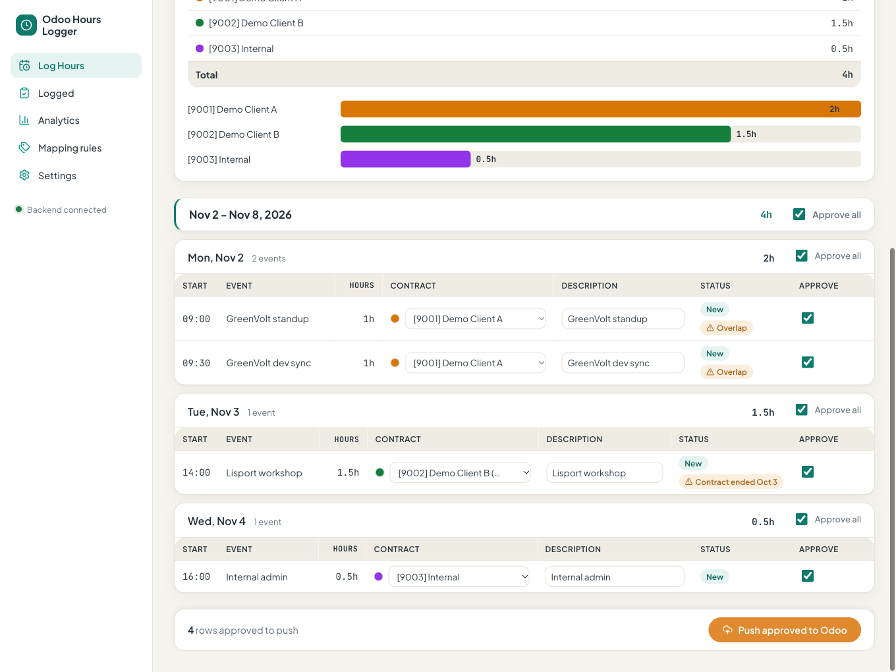
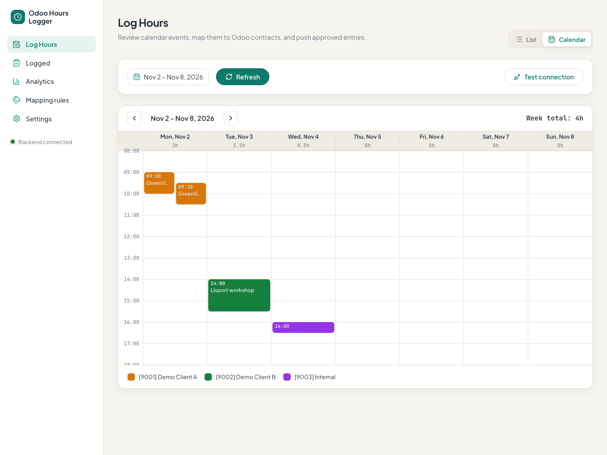
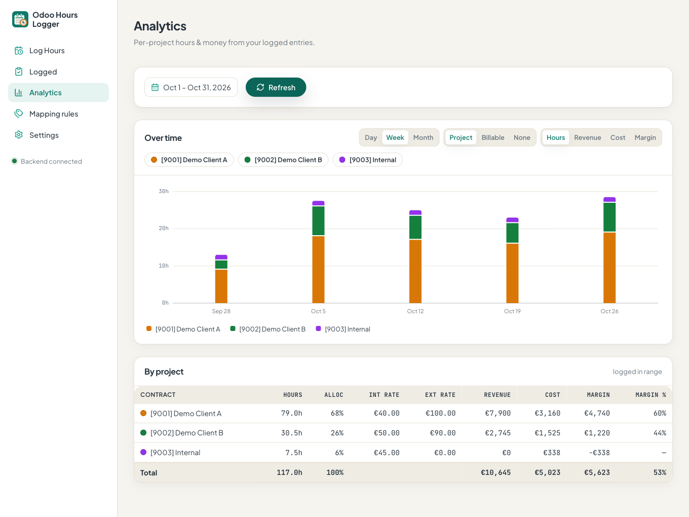
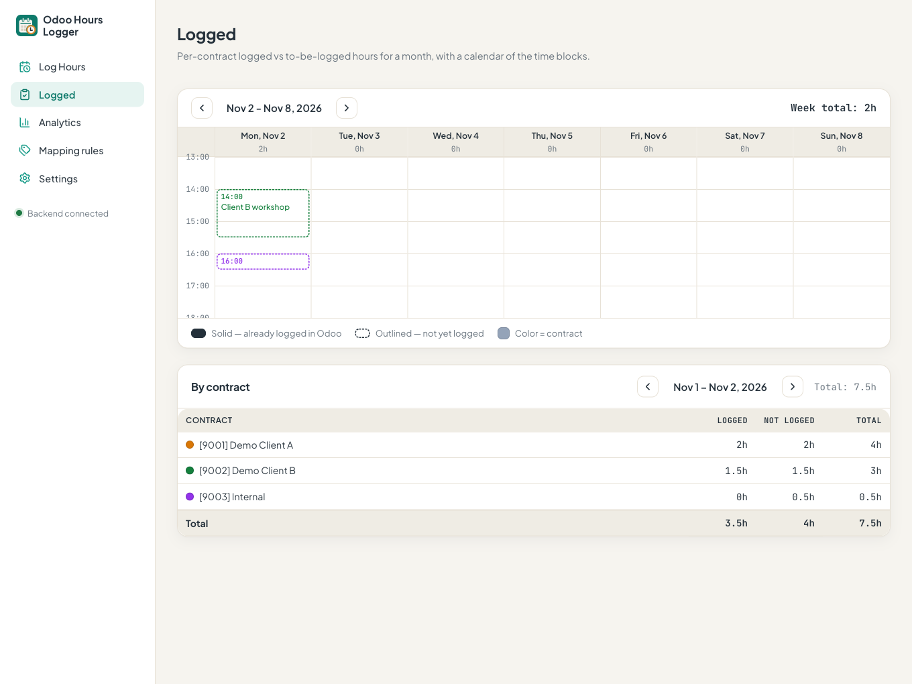
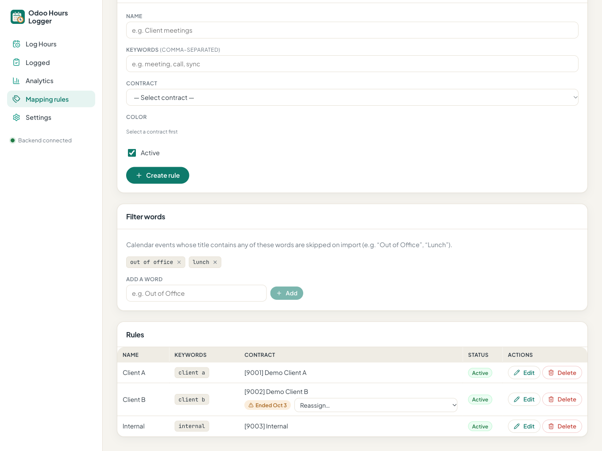

<div align="center">


# Odoo Hours Logger

**Turn your Google Calendar into Odoo timesheets. Review, then push.**




<sub>Screenshots use the built-in demo data.</sub>

</div>

## What it does

Reads your Google Calendar, maps each event to an Odoo **contract** with keyword rules, lets you **review** the proposed entries, then **pushes** them to Odoo's timesheet. It runs locally: plain keyword matching, plain JSON state files, no database, no LLM.

1. **Import**: pick a date range and refresh; events come from your calendar's secret iCal URL.
2. **Match**: keyword rules map each event title to a contract (first match wins); filter words drop noise like "Lunch".
3. **Review**: change the contract or description, remove stray events, approve what you want.
4. **Push**: approved entries are created in Odoo. Rows already logged are greyed out, so re-imports never double-log.

## Features

- **Calendar import** with recurring events expanded; all-day and declined events skipped.
- **Keyword rules** with per-contract colors. When you pick a contract by hand, the app offers to save it as a rule.
- **Contract warnings**: rules pointing at an ended contract and rows outside a contract's dates are flagged, with a reassign dropdown.
- **Review before push**: approve all, per week, per day, or per row.
- **List and calendar views**, color-coded by contract, with overlaps shown side by side.
- **Logged overview**: logged vs. to-be-logged hours per contract, with a calendar of the blocks.
- **Analytics**: a stacked column chart over time (day, week or month; by project or billable; hours, revenue, cost or margin) and a per-project table.
- **API-key sign-in** to Odoo, with a "check your VPN" prompt when Odoo is unreachable.
- **Demo mode**: runs on sample contracts and events, no Odoo or calendar needed.

## Screenshots

<table>
  <tr>
    <td width="50%"></td>
    <td width="50%"></td>
  </tr>
  <tr>
    <td align="center"><b>Calendar view</b><br />Blocks color-coded by contract</td>
    <td align="center"><b>Analytics</b><br />Hours, revenue, cost and margin over time</td>
  </tr>
  <tr>
    <td width="50%"></td>
    <td width="50%"></td>
  </tr>
  <tr>
    <td align="center"><b>Logged</b><br />Logged vs. to-be-logged per contract</td>
    <td align="center"><b>Mapping rules</b><br />Keywords to contracts, with filter words</td>
  </tr>
</table>

## Quick start

You need Python 3.12+ and Node.js.

```bash
# Backend
cd backend && python -m venv .venv && . .venv/bin/activate && pip install -e ".[dev]"

# Frontend
cd ../frontend && npm install

# Config (or fill it in later from the Settings tab)
cd .. && cp backend/.env.example backend/.env

# Run both: backend on :8010, frontend on :5173
./run.sh
```

Open **http://localhost:5173**.

**Just looking around?** Set `DEMO_MODE=true` in `backend/.env` to run on sample data with a simulated push.

### Configuration

| Setting | Where to get it |
|---|---|
| `GOOGLE_CALENDAR_URL` | Google Calendar → Settings → your calendar → Integrate calendar → **Secret address in iCal format** |
| `ODOO_USERNAME` | Your Odoo login email |
| `ODOO_API_KEY` | Open `<ODOO_URL>/web?debug=1` → avatar → My Profile → Account Security → Developer API Keys → **New API Key** (the Settings tab walks you through it) |

You can edit everything in the **Settings** tab; it saves to `backend/.env` and applies immediately. The full variable reference and the technical walkthrough are in [`docs/GUIDE.md`](docs/GUIDE.md).

## Desktop app (macOS)

Build a standalone `Odoo Hours Logger.app` that you can keep in `/Applications`, with no terminal needed at runtime.

```bash
# After the Quick start setup above, add the build tools
cd backend && . .venv/bin/activate && pip install -e ".[dev,packaging]" && cd ..

brew install librsvg    # optional: generates the app icon
./build_app.sh          # builds dist-app/Odoo Hours Logger.app

mv "dist-app/Odoo Hours Logger.app" /Applications/
```

- **First launch:** the app is unsigned, so right-click it in Finder → **Open** once to get past Gatekeeper.
- **Config and data:** the first build copies your `backend/.env` and `backend/data/` to `~/Library/Application Support/Odoo Hours Logger/`. The installed app reads and writes there, and rebuilding leaves it untouched.
- **Odoo access:** the company VPN is still required.

## Tech stack

| | |
|---|---|
| **Backend** | Python 3.12, FastAPI, httpx, icalendar and recurring-ical-events, Odoo web JSON-RPC, JSON files |
| **Frontend** | React, TypeScript, Vite, plain CSS design system |
| **Tests** | pytest, Vitest and React Testing Library |

## Tests

```bash
cd backend && . .venv/bin/activate && pytest
cd frontend && npm test
```
